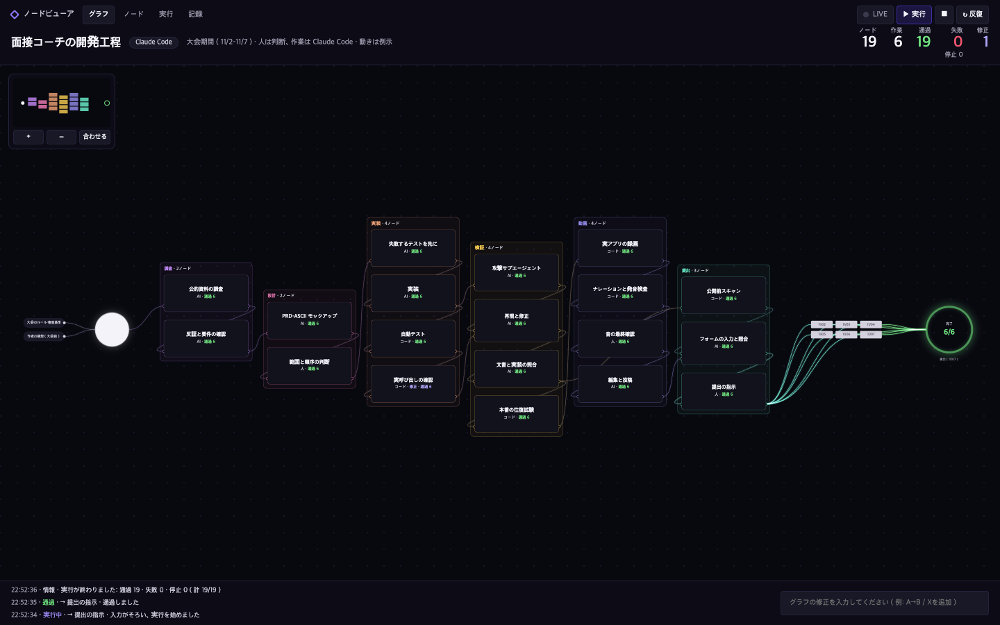

# 開発工程の記録 — Claude Code が担ったことと、作者が決めたこと

この文書は、面接コーチを大会期間中にどう作ったかを、確かめられる証拠とともに示します。工程の流れは [`docs/dev-pipeline.html`](../../docs/dev-pipeline.html)（外部ライブラリなしの HTML 1ファイル、ダウンロードしてダブルクリックで開けます）でも見られます。

## 範囲

- **大会前（10/28まで）:** 作者が応募の構想を立て、候補の中から本案を選びました。初回コミット `03fd4a5` に含まれる構想資料3件は、このとき作者が用意したもので、11/06 に最新の状態から削除しました（git の履歴には残っています）。
- **大会期間中（11/2 12:30〜11/7）:** 開発に使った AI ツールは Claude Code だけです。調査、設計、実装、テスト、攻撃によるレビュー、評価、デモ動画の制作（録画・編集・ナレーション・発音の検査・投稿）、提出フォームの入力と照合、本番の確認を Claude Code が行いました。
- **作者の役割:** 判断、承認、フィードバックです。ほかに、アカウントの作成と支払いの設定、音の最終確認、自分のデータを使った試験、提出の指示を作者が行いました。
- **添削ルールの元データ:** 作者が以前の面接の失敗から作った添削の記録です。大会前の資料で、`packs/jp.json` のルールデータとしてのみ使っています（README 「制約と未対応」）。

## 工程ごとの証拠

| 工程 | Claude Code がしたこと | 作者がしたこと | 公開している証拠 |
|---|---|---|---|
| 調査 | 公的資料の調査を複数のエージェントに分け、主張ごとに出典を付けました。別のエージェントが反証しました | 調査範囲の承認 | [`research/`](../research/)、[`agent-workflows/research-r1-web.js`](agent-workflows/research-r1-web.js)、[`verify-research-prd.js`](agent-workflows/verify-research-prd.js) |
| 設計 | PRD と ASCII モックアップを書き、6観点の批判と反証を経て修正しました | 範囲・順序・機能の判断 | [`PRD-INTERVIEW-COACH.md`](../PRD-INTERVIEW-COACH.md)、[`archive/`](../archive/)（版ごとの変化）、[`UIUX-SPEC.md`](../UIUX-SPEC.md) |
| 実装 | 失敗するテストを先に書き、実装しました。スキーマを変えたら実呼び出しを1回行う手順をスキルにしました | 画面とふるまいへのフィードバック | git の履歴（コミット121件）、[`test/`](../../test/)、[`.claude/skills/`](../../.claude/skills/) |
| 検証 | 自分のアプリを攻撃するサブエージェントを走らせ、再現できた指摘だけを失敗するテストで固定して直しました。文書と実装の食い違いも別の編成で直しました。本番では全機能を往復で確かめ、実際のブラウザでも操作しました | 指摘の採否 | [`aggressive-audit.js`](agent-workflows/aggressive-audit.js)、[`docs-truth-sync.js`](agent-workflows/docs-truth-sync.js)、[`evidence/`](evidence/)（本番の往復試験） |
| 評価 | 評価セットを作り、別のエージェントが曖昧なラベルを除きました。実 API の評価を実行しました | 正解ラベルの見直し | [`eval-adversarial-gold.js`](agent-workflows/eval-adversarial-gold.js)、[`scripts/eval.mjs`](../../scripts/eval.mjs)、README 「評価」 |
| 動画 | 実際のアプリを操作して録画し、絵コンテどおりに編集しました。ナレーションを生成し、46行の読みを検査して音声認識で照合しました。限定公開で投稿しました | 音の最終確認、採用の判断 | [`scripts/record-video.mjs`](../../scripts/record-video.mjs)、[`build-video.mjs`](../../scripts/build-video.mjs)、[`narration.mjs`](../../scripts/narration.mjs)、[`evidence/`](evidence/)（発音の検査、投稿） |
| 提出 | 公開前のスキャンを行い、提出フォームを入力して保存しました。保存後に再表示し、全欄を原文と照合しました | 提出内容の判断と提出の指示 | [`publish-check`](../../.claude/skills/publish-check/)、[`evidence/`](evidence/)（フォームの入力と照合） |
| 公開と運用 | 本番のデプロイと配信内容の確認を手順に沿って行いました | 環境変数の値の作成 | [`deploy-verify`](../../.claude/skills/deploy-verify/) |

[`evidence/`](evidence/) の各ファイルは、大会期間中に実際に動かしたスクリプトから、識別子・秘密情報・点数を伏せた写しです。内容は [`evidence/README.md`](evidence/README.md) にまとめています。

## 作業量（Claude Code のセッション記録から集計）

作者の端末に残る Claude Code のセッション記録（`~/.claude/projects/`）から、件数と名前だけを数えました。本文、プロンプト、ファイルの中身は読んでいません。集計の時点は **11/07 22:49 JST** で、11/07 は途中までの値です。

| 項目 | 大会期間の合計 |
|---|---:|
| メインのセッション | 11 |
| 作者が入力した指示 | 318 |
| サブエージェント（そのうち Workflow の段階エージェント） | 638（556） |
| Claude Code のツール呼び出し（メイン＋サブエージェント） | 15,799（3,542＋12,257） |
| 作者の指示1件あたりのツール呼び出し | 約50 |
| リポジトリ内で編集したファイル | 228 |

| 日付 | セッション | 作者の指示 | メインのツール呼び出し | サブエージェント | サブエージェントのツール呼び出し |
|---|---:|---:|---:|---:|---:|
| 11/02（12:30〜） | 4 | 35 | 562 | 268 | 2,188 |
| 11/03 | 3 | 66 | 1,031 | 92 | 2,628 |
| 11/04 | 2 | 45 | 334 | 138 | 1,865 |
| 11/05 | 2 | 50 | 372 | 36 | 1,199 |
| 11/06 | 3 | 81 | 516 | 86 | 3,850 |
| 11/07（22:49まで） | 2 | 41 | 727 | 19 | 527 |

- **使ったモデル:** メインは Claude Opus 5.5 です。サブエージェントでは Opus 5.5 のほかに Claude Fable 5.1（難しい判断の相談役）、Sonnet 5.5（調査）、Haiku 5.5 を使いました。
- **主な機能:** サブエージェント（直接の呼び出し76回）、Workflow（63回）、Skills（プロジェクトのスキル4個と、Claude API の資料・ブラウザ操作などのスキル）、ブラウザ操作（MCP の Claude in Chrome）を使いました。
- **数え方:** 「作者が入力した指示」は、人が入力した記録だけを数えています。ツールの結果、フックやシステムが差し込んだ文、スラッシュコマンド（43件）は含めていません。同じ記録の再書き込みは1件として数えています。
- **集計スクリプト:** [`session-stats/agg.py`](session-stats/agg.py)（`python3 -I agg.py` で同じ表を作ります。出力の写しは [`session-stats/stats-2026-11-07-2249.txt`](session-stats/stats-2026-11-07-2249.txt)）。

## 作者が決めたことの例

作者は判断の記録を別に残しています（非公開。配備 ID や秘密情報の扱いを含むため）。そこから、公開してよいものを抜き出しました。

- **順序:** すべての機能をローカルで試し、完了と判断したときだけコミット・デプロイし、本番で実際に試す。その実例（合成の入力だけ）で動画を作る。（11/06）
- **利用の上限:** コードなしの利用は IP ごとに1日4回（想定質問の生成1回と、回答1件の採点・模範スクリプト・照合の3回）。（11/06）
- **動画:** 採点表の機能をすべて画面に出す。時間のために機能を削らない。（11/06）
- **製品のふるまい:** 自己紹介の締めは、時間の指定があれば挨拶と応募先への接続で短く、指定がなければ場面に合わせる。（11/06）
- **秘密情報:** 審査用コードは審査員専用の欄だけに書く。動画・リポジトリ・公開の欄には書かない。（11/06）
- **人が行うこと:** 音の確認は作者が自分の耳で行う。難しい判断はまず相談役のモデル（Fable）に聞き、選択が必要なことは作者に聞く。

## 限界

- コミットの作者はすべて作者のアカウントで、`Co-Authored-By` の行は付けていません。Claude Code が行ったことの証拠は、この文書、Workflow のスクリプト、`evidence/` のスクリプト、セッションの集計です。
- セッション記録そのものは公開していません。作者の個人データや秘密情報を含むためです。
- 集計は作者の端末に残る記録だけが対象です。11/07 は途中までの値です。
