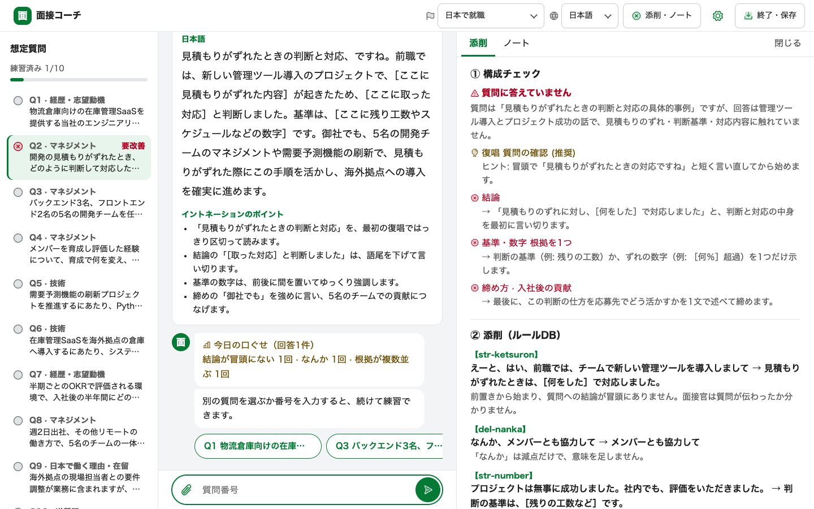
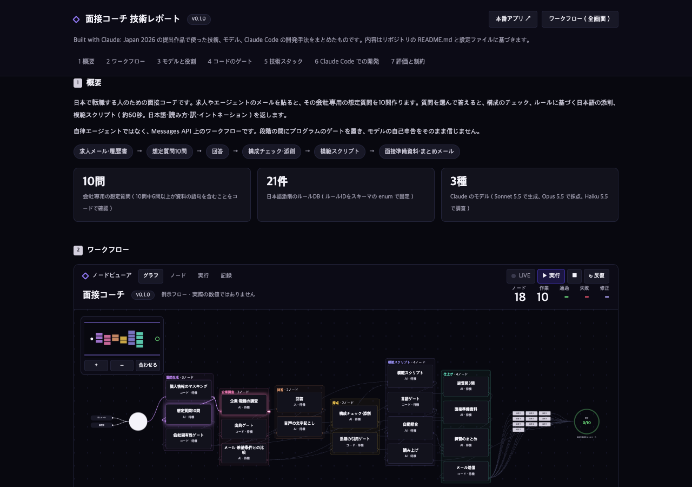
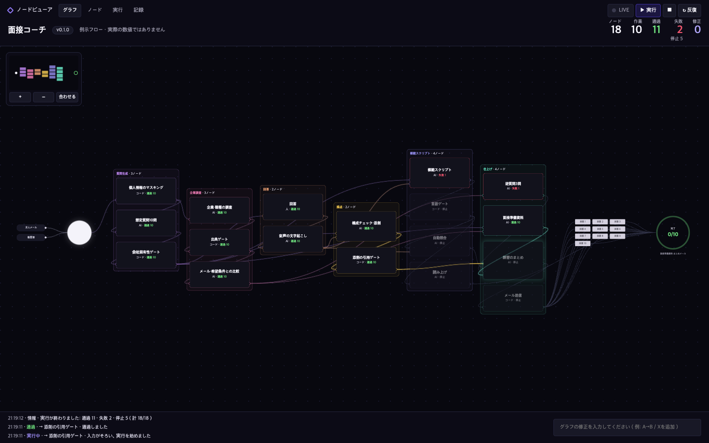

# 面接コーチ（メンセツ・コーチ）

日本で転職する人のための面接コーチです（画面の言語が日本語以外なら、解説・読み方・訳がその言語で付きます）。求人やエージェントのメールを貼ると、その会社専用の想定質問を10問作ります。質問を選んで答えると、①「質問に答えているか」と構成のチェック（作者の4文（復唱・結論・基準か数字・選択肢）をもとに、締めを質問タイプ別に広げた型）、②ルールに基づく日本語の添削、③模範スクリプト（約60秒。条件・事実の質問は短く。日本語・読み方・訳・イントネーション）を返します。Built with Claude: Japan 2026 の提出作品です。

**本番アプリ:** https://mensetsu-coach-ten.vercel.app （提出版の設定では、コードなしで1日の上限まで使えます。AI を呼び出さないツアーは上限に数えません）



画面は架空の求人メールで撮影しました（モックのサーバーと、ツアーと同じ録画の出力を使用。AI の呼び出しはありません）。

**技術レポートとワークフロー:** 使った技術・モデル・Claude Code の開発手法は [`docs/report.html`](docs/report.html)、処理の流れ（どの段階を誰が担い、どこで止まるか）は [`docs/node-viewer.html`](docs/node-viewer.html) にまとめています。どちらも外部ライブラリのない HTML 1ファイルで、ダウンロードしてダブルクリックで開けます（GitHub 上ではソースとして表示されます）。ワークフローの数値は例示で、実測ではありません。

| 技術レポート（[`docs/report.html`](docs/report.html)） | ワークフロー（[`docs/node-viewer.html`](docs/node-viewer.html)） |
|---|---|
| [](docs/report.html) | [](docs/node-viewer.html) |

> **現在の状態（2026-11-06）**: 下記「実装範囲」の実装済みの機能は本番環境にデプロイ済みです。メール登録（11/07 追加）は、「終了・保存」の後に登録すると、その日の練習のまとめと次のメールのプレビューの2通をすぐに送ります。定時の自動配信は運営者の設定（`MAIL_ROUTINE=1`）のときだけ動き、提出版では止めています。

## きっかけ
韓国出身のエンジニアである作者は、以前の転職活動の面接で見送りになりました。その録音を文字起こしすると、面接官に同じ質問を3回聞き返されていました。原因は日本語の上手さではなく、聞かれた質問ではなく準備した別の答えを話していたことでした。
主な対象である「技術・人文知識・国際業務」の在留資格を持つ外国人労働者は468,068人で（2025年10月末、厚生労働省「外国人雇用状況」別表）、このうち「日本国内の別の会社に移りたい」という回答は5.5%です（「令和7年 外国人雇用実態調査」第21表。転職希望であり、実際の転職率ではありません）。

## 試し方（手順4までは約2分）
1. https://mensetsu-coach-ten.vercel.app を開き、画面右上で「日本語」を選びます。
2. **コードなしで**、最初のメッセージの下にある「▶ ツアー」を押します。架空の求人メールで実際の出力を録画したものを、16ステップ（「次へ」）で再生します（AIは呼び出しません）。質問・添削・模範スクリプトに加え、口ぐせ、台本の検証、逆質問、段階別の準備資料、カレンダー・練習の記録・振り返り、画面の言語と行き先、保存とメール登録まで、すべての機能を順に示します。企業調査のステップだけは録画ではなく、画面に「架空の例」と表示する手書きのサンプルです。
3. 自分で試す場合は、[`samples/agent-mail-sample.txt`](samples/agent-mail-sample.txt)（架空の求人メール）の本文を貼り付けて送信します（Ctrl/⌘+Enter）。提出版では、コードなしで AI を呼び出せるのは IP アドレスごとに1日4回です（想定質問の生成で1回、回答1件の採点・模範スクリプト・照合で3回）。上限に達すると案内が出ます。審査時に別途お知らせする審査用コードを、案内の下の欄か［オプション］の「審査用コード」に入力すると、上限が外れます。
4. 想定質問のカード（Web では左の質問一覧）で［練習する］を押し（番号の入力でも選べます）、わざと質問とずれた答えを書いてみてください（例は [`01_設計文書/TEST-CASES.md`](01_%E8%A8%AD%E8%A8%88%E6%96%87%E6%9B%B8/TEST-CASES.md) のケースB）。模範スクリプトが出たあと、回答にない内容がスクリプトに入っていないかを自動で照合し、スクリプトのカードに結果を表示します。
5. 企業・職種の調査を試す場合は、質問カードの下までスクロールすると出る「この企業と職種を調査しますか？」のカードで、企業名を実在の企業名に書き換えて［調査を始める］を押します（1〜2分）。サンプルの会社は架空のため、そのままでは情報がほとんど見つからない見込みです。見つからない情報を作らない設計です。
6. 面接準備資料を試す場合は、質問カードの下にある［面接準備資料］を押し、[`samples/resume-sample.txt`](samples/resume-sample.txt)（架空の履歴書）の本文を「履歴書を貼り付け」に貼り付けて［資料を作る］を押します（最大で3分ほど）。任意の欄は空のままで構いません。その項目は資料に空欄で表示されます。「面接の段階」（カジュアル面談〜「内定・条件」）を変えると、作る節と注意点が変わります。
7. 自分の台本を検証する場合は、質問を選んで［台本を検証］を押し、台本を入力欄に貼って［検証する］を押します（架空の例は、[`samples/resume-sample.txt`](samples/resume-sample.txt) を「履歴書・求人メール」の欄に貼り、履歴書にない数字を台本に入れて試します）。資料の欄が空なら、根拠の確認は行わず「資料がないので未確認」と表示します。
8. 予定を入れる場合は、質問カードの下の［カレンダーに登録］で種類（面接・練習）と日時を選び、［Google カレンダーで開く］を押します。Google の予定作成画面に、題名と日時だけを入れて開きます（ツアーでも使えます）。

## 実装範囲

| 機能 | 状態 |
|---|---|
| 企業メール・求人情報の貼り付け → 企業・ポジションの要約 | 実装済み |
| 想定質問10問（面接段階・カテゴリ・日本語・解説言語の訳・根拠1行） | 実装済み |
| 履歴書・職務経歴書の添付（PDF、画像、DOCX、TXT/MD、3MB以下） | 実装済み |
| 企業・職種の自動調査（公式サイト・公的書類・報道・求人から出典付きで要約し、メールや希望条件との違いを確認ポイントとして表示。判定はしない。情報が足りなければ「結果が不足しています」と表示） | 実装済み（日本パックのみ） |
| 面接の段階（面接準備資料で、カジュアル面談、一次面接、二次面接、役員面接、最終面接、「内定・条件」の6種から選ぶ。段階ごとに作る節、重点、注意点が変わる。「内定・条件」では、年収・条件の節に金額や日付を［ここに〜］の空欄にした確認の文例を入れる。資料のカードと Markdown に段階を表示） | 実装済み（日本パックのみ、面接準備資料と同じ条件） |
| 面接準備資料（履歴書と任意の入力から、節の順序が決まった Markdown 資料を作成。各質問に、聞かれていること・話す順序・例文・読み方・訳を付ける。入力にない事実は［ここに〜］の空欄にするようモデルに指示するが、コードでは作り話を完全には防げないため、内容は本人の確認が必須。画面で確認してダウンロードできる） | 実装済み（日本パックのみ）。日本語画面と、入力をそのまま載せる項目には読み方・訳なし。コードの既定はオフで、環境変数 `PREP_ENABLED=1` のときだけ表示。本番環境では有効。以前の面接資料を使って実際の API で評価済みだが、生成文の事実の判定は作成者の確認に委ねている |
| 質問番号の選択 → 回答 → 模範スクリプト（日本語の敬語・読み方・訳・イントネーションのポイント2〜4個） | 実装済み。読み方は韓国語画面ではハングル、English画面ではローマ字（どちらもモデルはひらがなで書き、コードが変換）。日本語画面は読み方・訳なし。↗ 上げる · ↘ 下げる · 《 》 強調 · / 区切り |
| 模範スクリプトの自動照合（模範スクリプトの表示後、自分の回答と照らし、回答から根拠が見つからない経歴・数字・成果・判断・動機の文を挙げる。照合できなかった場合はスクリプトを残して「回答と照合できませんでした」と表示） | 実装済み（`claude-sonnet-5-5`、模範スクリプト1件につき1回）。嘘とは断定せず、書き換えも提案しない。結果はブラウザのセッションにだけ保存 |
| 自分の台本の検証（質問を選び、［台本を検証］で台本を貼ると、質問に答えているか、4文型、ルールに基づく添削、話す時間（自己紹介は目安90秒、条件・事実の質問は判定なし、それ以外は60秒。範囲で示し、超えたときだけ注意）、残りの空欄の数、根拠が見つからない文を表示。任意で貼った履歴書・メールと照合し、資料がなければ「資料がないので未確認」と表示。貼った資料と台本は保存しない） | 実装済み。質問ごとの検証のみ。根拠が見つからない文は台本に実在する文だけをコードで通し、嘘とは断定しない |
| カレンダー登録（質問カードの下の［カレンダーに登録］から、面接（既定60分）または練習（既定30分）の日時を Google カレンダーの予定作成画面に渡す。題名は「面接」か「面接の練習（質問 N 問）」だけ） | 実装済み。OAuth もサーバーの呼び出しもなく、Google の予定はアプリに戻らない。同じ予定をもう一度保存すると予定が増える（画面で案内）。自動テストはリンクの形式までを確認 |
| 練習の記録（質問カードに練習した回数と最後の日時、Markdown の保存に各練習の日時（日本時間）） | 実装済み。ブラウザ内のみ |
| 利用の上限（コードなしは1日の上限まで使い、上限に達すると案内を表示。審査用コードで上限を解除） | 実装済み。環境変数 `OPEN_ACCESS=1` のとき。未設定なら従来どおりコードが必須 |
| 画面言語（한국어（韓国語）・English・日本語、ブラウザの言語が既定、選択を記憶） | 実装済み |
| スマートフォンとPCの両対応（スマートフォンはチャット形式の1列、PCは質問一覧・会話・添削の3列） | 実装済み。ブラウザのテストで両方の画面幅を確認（390×844、1280×720、1440×900） |
| （任意）経歴1行 → 質問の作り直し（質問の表示後のみ、保存しない） | 実装済み |
| 口ぐせカウンター（セッション内の添削をルール別に数え、2回以上で ⚠） | 実装済み |
| 逆質問3問＋意図（条件に関する質問はエージェントへ） | 実装済み（`claude-sonnet-5-5`） |
| コードなしで見るツアー（実際の出力の録画を16ステップで再生し、すべての機能を説明、3言語。企業調査のステップのみ手書きの架空サンプル） | 実装済み |
| 終了・保存（セッション全体をMarkdownでダウンロードして消去） | 実装済み |
| プライバシーポリシー（`/privacy.html`、国外委託の告知） | 実装済み |
| 練習のまとめメール（「終了・保存」の後の登録画面で登録すると、①その日の練習のまとめ（Claude が記録を整理。失敗・上限超過のときは記録をそのまま送る）と②次のメールのプレビュー（調査で集めた最近のニュース・ポジションの論点・日本語の模範回答例。AI 呼び出しなし）をすぐに送信。配信停止リンク付き。定時配信は運営者の任意設定 `MAIL_ROUTINE=1`） | 実装済み（11/07）。メールの内容は今後、補強・追加する予定です。送信は運営者の Gmail（SMTP） |
| 回答の構成チェック（質問に答えたか＋復唱（推奨）→結論→基準・数字→締め（質問タイプ別: 選択肢・貢献・改善・質問、自己紹介は時間の指定があれば挨拶か応募先への接続、指定がなければ場面に合わせて選択肢も可、条件・事実の質問は事実を短く）） | 実装済み。採点は生成と分離した別の呼び出し（`claude-opus-5-5`）。模範スクリプトが復唱から始めるのは判断・状況の質問だけ |
| 日本語の添削（ルールDB 21件、ルールID表示） | 実装済み。回答にある箇所を引用した添削だけを表示。ルールIDは21件に固定し、語彙ルール16個は引用箇所の表現もコードで確認。構造ルール5個（str-*）の適用はモデルの判定 |
| 模範スクリプトの読み上げ（「スクリプトを聞く」、読んでいる箇所を緑で追う） | 実装済み（Gemini TTS、使えない場合は端末の音声） |
| 🎤 音声での回答（ブラウザ内で文字起こし、録音は端末の外に出さない、フィラーを残す） | 実装済み（オープンソースの Whisper-small、端末の下限は RAM 4GB） |
| 練習モード（F8） | 実装しない — 現在の「番号選択 → 回答 → チェック」の繰り返しで代替 |

## 実行方法

要件: Node.js 20.12 以上、Anthropic API キー

```bash
npm install
cp .env.example .env    # ANTHROPIC_API_KEY, ACCESS_CODE を入力
npm run dev             # http://localhost:3000
```

- 「スクリプトを聞く」ボタン（模範スクリプトの読み上げ）は、`GEMINI_API_KEY`（任意）がある場合に動作します。キーがない場合は端末の音声（Kyoko・Google 日本語）で読み上げ、端末の音声もない場合は再生できないことを案内します。
- 🎤 音声回答は**常にオンで、ブラウザ内で認識します**。オープンソースの Whisper-small（transformers.js）を使い、録音は端末の外に出ません。認識言語は面接言語（ja/ko）の1つに固定し、フィラー（えーと・なんか・음（うーん）・어（あー））を残すようにプロンプトを付けます。認識モデル（約260MB）は初回利用時に huggingface.co から一度ダウンロードし、ブラウザにキャッシュします。端末の下限は RAM 4GB です（Android 8GB・4GB は通過、2GB はタブが落ちる。根拠 `01_設計文書/research/STT-OSS-EVAL.md`）。
- 音読チェック（模範スクリプトを声に出して読む）は、コードの既定ではオフで、`STT_ENABLED=1` のときだけ動きます。**提出版の本番では有効にしています**（11/06）。聞こえたとおりのひらがなが必要なため Gemini の無料枠を使います。無料枠の規約は個人情報の送信を禁止しているため（"Do not submit … personal information to the Unpaid Services"）、録音を始めるときに「氏名・会社名は話さないでください」と画面に1行で案内します。送るのは模範スクリプトを読んだ音声だけです。この値がない場合、`/api/stt` は音声を読む前に 503 を返し、画面にも音読ボタンが表示されません。
- `ACCESS_CODE` は自分で決める値です。`OPEN_ACCESS` が未設定なら、画面でこの値を入力しないと AI を呼び出す API は使えません。`OPEN_ACCESS=1` にすると、コードなしで1日の上限まで使える公開モードになります。上限は `DAILY_LIMIT`（全体）と `DAILY_LIMIT_IP`（IP アドレスごと）で変更でき（整数のみ）、日本時間0時にリセットされます。提出版の値は全体60回、IP ごと4回です。`ACCESS_CODE` を入力すると上限が外れます。回数は `KV_REST_API_URL`/`KV_REST_API_TOKEN`（Upstash Redis）に保存し、未設定ならサーバーのメモリで数えます。
- `.env` をリポジトリの外に置く場合は、`ENV_FILE=/path/to/.env npm run dev` で実行します。
- `npm test`: オフラインの単体テストと個人情報パターンの検査。`PII_DENYLIST` に個人情報リストファイルのパスを渡すと、そのリストでも検査します。リストファイルはリポジトリにはありません。
- `npm run test:live`: 実際に Claude を呼び出します。費用が発生し、約35秒かかります。
- デプロイ: Vercel。プロジェクトの環境変数に `ANTHROPIC_API_KEY` と `ACCESS_CODE` を設定します（音声を使う場合は `GEMINI_API_KEY` も。企業・職種の調査は `RESEARCH_ENABLED=1`、面接準備資料は `PREP_ENABLED=1`、公開モードは `OPEN_ACCESS=1` と `DAILY_LIMIT`・`DAILY_LIMIT_IP`・`KV_REST_API_*`、メール登録は `MAIL_PUBLIC=1` と `SMTP_USER`・`SMTP_PASS`（Gmail のアプリパスワード）・`MAIL_SECRET`・`APP_URL`、定時配信は `MAIL_ROUTINE=1` と `CRON_SECRET` で有効になります）。`vercel.json` に CSP などのセキュリティヘッダーがあります。

## Claude の使い方

| 目的 | 選んだもの | 選ばなかったものと理由 |
|---|---|---|
| 回答の採点を甘くしない | 生成は `claude-sonnet-5-5`、構成チェックと添削は別の呼び出しの `claude-opus-5-5`（`lib/claude.js`） | 生成と採点を1回の呼び出しで行う形。作ったモデルが自分の答えを採点することになるためです |
| 企業の公開情報を、費用を抑えて調べる | `claude-haiku-5-5` と、基本版の `web_search_20250305`・`web_fetch_20250910`（`lib/research.js`） | 新しい版の検索ツール。Haiku との組み合わせでは、実呼び出しで検索が0回でした |
| 応募者の資料を検索に出さずに、調査結果と比べる | ツールを持たない `claude-sonnet-5-5`（`lib/research.js` の比較の呼び出し） | 検索ツール付きの1回の呼び出し。資料の内容が検索語に入る余地が残るためです |
| 自分の成果物の欠陥を見つける | ファイルを変更しないよう指示したサブエージェントによる攻撃（例: `01_設計文書/dev-notes/agent-workflows/aggressive-audit.js`）。指摘は別のエージェントで反証します | 作ったエージェント自身の確認だけで済ませる形。アプリのゲートと同じく、自己申告をそのまま信じないためです |
| 取り消せない作業の手順を漏らさない | Skills 4個。`publish-check` と `deploy-verify` は手動のみ（`disable-model-invocation: true`）、`prompt-change-check` と `add-pack` は関連の作業で自動でも読み込みます | すべて自動にする形。公開やデプロイが意図せず動くことを防ぎ、説明文も常に読み込まないためです。残りの2個は、呼び忘れを減らすために自動を残しました |
| 公開前の検査を、Claude Code の外でも動かす | git の `pre-push` フック（各自のローカルで設定、`scan.mjs` を実行） | 検査を Claude Code のフックに置く形。Claude Code を通さない `git push` で動かないためです。Claude Code のフック（RTK によるコマンドの書き換えなど）は作者の個人環境の設定で、このリポジトリには含めていません |

MCP はアプリにも開発の手順にも組み込んでいません（`.mcp.json` はなく、アプリからの呼び出しもありません）。Web 検索は Anthropic のサーバー側ツールです。

- 自律エージェントではなく、Messages API 上のワークフローです。段階の間にプログラムのゲートを置き、モデルの自己申告をそのまま信じません。
- 段階とモデル:
  - 想定質問10問: `claude-sonnet-5-5`（構造化出力）
  - 構成チェック＋添削: `claude-opus-5-5`（生成とは別の呼び出し）
  - 模範スクリプト・逆質問: `claude-sonnet-5-5`
  - 企業・職種の調査: `claude-haiku-5-5`（Web 検索・ページ取得、構造化出力）
  - 調査結果とメール・希望条件の比較: `claude-sonnet-5-5`（ツールなし）
  - 練習のまとめメール: `claude-sonnet-5-5`（ツールなし、登録時に1回。1日の上限に数える。失敗・上限超過のときは記録をそのまま送る）
  - 台本の検証: 構成チェック＋添削は上の呼び出しを再利用（回答として渡す）。話す時間と空欄の数はコードで計算（AI 呼び出しなし）。根拠が見つからない文だけ `claude-sonnet-5-5`（ツールなし、資料があるときだけ1回）。模範スクリプトを作るたびに、回答を資料として同じ確認を1回自動で行います
  - 面接準備資料: `claude-sonnet-5-5`（節のまとまりごとに並列で呼び出す構造化出力。会社の事実・固定の文・空欄の集計はコードが組み立てる）
  - 上のモデル名は既定です。想定質問・構成チェック＋添削・模範スクリプト・逆質問・面接準備資料は `fallbacks: "default"`（server-side fallback、ベータ）を指定しており、Anthropic の分類器がリクエストを断ると、断られた理由に応じて Anthropic が推奨する別のモデルが応答することがあります。調査と比較、台本の照合では指定していません
- ゲート:
  - 日本語欄が日本語でなければ1回だけ再生成し、2回目も失敗すればエラーを返す（ハングル、かなのない長い漢字文＝中国語、英語が中心の文）。日本語欄が通り、読み方・訳・発音のポイントだけが選んだ言語の文字でない場合は、その項目だけをもう1回求め、それでも誤っていればその項目を表示しない（エラーにはしない）
  - 逆質問の意図が選んだ言語で書かれていない場合は1回だけ再生成し、2回目も同じなら、日本語で書かれた意図に限ってそのまま表示する
  - 10問中6問以上が資料の語句を含む（一般語は数えない）
  - 添削ルールIDはスキーマのenumで固定し、回答にない箇所を引用した添削は捨てる。語彙ルール（16個）は、引用した箇所にそのルールの表現がなければ捨てる
  - 模範スクリプトの数字は、回答・質問・資料（メールから抽出した会社情報）にある数と一致するものだけ（なければ［空欄］）。「3,000」と「3000」、「三割」と「3割」は同じ数、「2015」の中の「15」は別の数として扱います
  - 模範スクリプトの文末の語が回答にない文は、カードに注意として表示します（文字の照合で、言い換えでも表示されます。回答が面接の言語で書かれているときのみ）
  - 調査の主張は、検索・取得の結果に実在する URL を引用し、同じ企業と確認できた出典だけを数える。企業の項目は公式・公的書類・報道、職種の項目は公式・求人媒体に限る。出典の種類はモデルの判定で、公式ドメインとの照合はしていません
  - 面接準備資料の数字と単位の組は、履歴書と質問にあるものだけを通す（漢数字は決まった単位が続くときだけ数字として検査）。肩書きは決まった語の一覧を、例文と追加質問について履歴書と質問に照合する（応募先のポジション名は、自己紹介と役割の回答以外では可）。例文の根拠として示された語句を入力と照合し、照合できない文、根拠のない文、履歴書と語句が重ならない過去形の文は「要本人確認」に集める。いずれも文字の照合で、事実の正しさは保証しない（在籍先の取り違えなどは検出できない）。空欄の数は資料の本文から数え直す。希望プロフィールは送らず、年収・条件の節はブラウザで組み立てる
  - 台本の検証で挙げる文は、台本を文に分けてコードで照合し、実在する文だけを通します。出力の項目は文と種類（経歴・数字・成果・判断・動機）だけなので、書き換えの提案や断定を書く欄がありません。空欄を含む文も、空欄の外で述べている内容を確かめます。空欄の中身と、台本の文と一致しなかった指摘は未確認として件数を表示します
- 入力は Claude に送る前に、メール・電話・郵便番号・宛名行をマスクします（全角の＠・数字、姓名の間に空白がある宛名行を含む）。貼り付けた資料の中の指示には従いません（評価で確認）。
- ルールパックの注入: 日本のルールパック（`packs/jp.json`）の添削ルールと4文型の基準をシステムプロンプトに入れ、「表にないルールで直さない」と明示します。当てはまらなければ添削は空で返します。構造ルール（str-*）は文の構造を見るため、表現の検査はしません。
- 添付ファイル: PDF と画像は Claude にドキュメント・画像ブロックとして直接送り、DOCX はテキストに変換して送ります。添付ファイルはディスクに保存しません。

## Claude Code での開発
Claude Code を開発の中心に置きました。試行と修正の経過はコミット履歴と `01_設計文書/DEVLOG.md` に残しています。プロジェクトの規則は `CLAUDE.md` にまとめ、毎回の作業で読み込ませています。

大きな作業は、Claude Code の Workflow（サブエージェントの編成）で進めました。使ったスクリプトの一部を `01_設計文書/dev-notes/agent-workflows/` で公開しています。

| スクリプト | 構成 | 目的 |
|---|---|---|
| `research-r1-web.js` | 複数の調査エージェント | 面接・書類の規範を公的資料から調査 |
| `verify-research-prd.js` | 6観点で批判 → 懐疑役が反証 → 修正 → 完全性の確認 | 調査の前に要件の穴をつぶす |
| `eval-adversarial-gold.js` | 生成 → 独立した反証役が曖昧なラベルを除去 | 表面の手がかりがない評価データを作る |
| `aggressive-audit.js` | 6観点で監査 → 観点ごとに懐疑役が反証 → 順位付け | 公開前の監査 |
| `docs-truth-sync.js` | 文書ごとに検出 → 懐疑役2体が検証 → 確認済みだけ修正 → 批評 | 文書と実装の食い違いを直す |

自分のアプリを攻撃するサブエージェント（セキュリティ、製品の主張、デモの経路）も走らせました。報告はそのまま信じず、手元で再現できたものだけを、失敗するテストを先に書いて修正しました。直した例は、DOCX の圧縮爆弾の検査回避、数字ゲートの部分一致（「2015年」があると「15%」が通る）、誤入力が続くと正しいアクセスコードまで拒否される問題です。

エージェントが作ったものを別のエージェントが反証する形にしているのは、アプリのゲートと同じ考え方です。モデルの自己申告をそのまま信じません。

### プロジェクトスキル

失敗すると取り消せない作業や費用のかかる作業の手順を、`.claude/skills/` に Claude Code のスキルとして置いています。Claude Code をこのリポジトリで開くと使えます。

| スキル | 呼び出し方 | 使う場面 | 防ぐ事故 |
|---|---|---|---|
| `publish-check` | `/publish-check` | コミット・プッシュの前 | 個人情報やシークレットの公開、誤った作者のコミット |
| `deploy-verify` | `/deploy-verify` | 本番デプロイの前後 | 未コミットの変更や無視ファイルの配信、反映されていない状態の見逃し |
| `prompt-change-check` | `/prompt-change-check`、または関連の変更時に自動 | プロンプト、モデル、スキーマ、ルールの変更後 | スキーマの 400 エラーの見逃し、不要な実呼び出しの費用、古いデモの放置 |
| `add-pack` | `/add-pack`、または関連の依頼時に自動 | 新しい国別パックの追加 | 登録漏れ、JP 専用機能の誤った有効化、動かないパックの見逃し |

**使い方**

```bash
# 公開前の点検を単体で実行する（スキルの手順 3）
node .claude/skills/publish-check/scripts/scan.mjs

# git の pre-push フックとして、プッシュのたびに同じ検査を実行する（ローカルに一度だけ設定）
printf '#!/bin/sh\nexec node .claude/skills/publish-check/scripts/scan.mjs\n' > .git/hooks/pre-push
chmod +x .git/hooks/pre-push
```

スキャンは非公開フォルダのリスト（`.pii-denylist.txt`、`.publish-terms.txt`、`.publish-identity.txt`、`.env`）と照合します。リストのない環境では、確認できないことを示す終了コード 2 で止まり、問題なしとは判定しません。

**長所**

- **注意点を毎回調べ直さなくて済みます。** コードからは読み取りにくい事項を手順の中に置いています。例: `vercel deploy` が未コミットの変更も送ること、調査スキーマの変更はオフラインのテストで検出できないこと、テストが飛ばされても成功に見えること。
- **費用を実行前に見積もれます。** 変更箇所ごとに必要な評価と呼び出し数を示し、関係のない実呼び出しを避けます。
- **公開前の検査が機械的に再現できます。** スキャンは、後のコミットで消した内容、ステージした内容、コミットメッセージ、作者まで調べ、検出した値は表示しません。git の `pre-push` フック（Claude Code のフックではありません）でも同じ検査が動きます。
- **常駐のコストが小さくなります。** 外部に影響する 2 つのスキルは手動呼び出しに限定し、説明文を常に読み込まず、意図しない実行も防ぎます。

**検証方法と限界**

- 同じ依頼をスキルあり・なしで実行して比較し、次に独立したエージェントが各スキルを攻撃しました。再現できた問題だけを直し、スキャンのすり抜けは `test/skills.test.js` の回帰テストに固定しています。
- 同じモデルはスキルがなくてもコードを読んで多くを導けます。比較は各 1 回で、ばらつきは測定していません。判定基準もスキルの作成者が書いたものです。スキルの主な効果は、見落としの低減と手順の統一と考えています。
- スキャンは単純な一致による検査です。空白で分割した語や base64 に変換した値は検出できず、検査するのは `HEAD` の履歴だけです。
- `deploy-verify` と `add-pack` の手順は、実際のデプロイやパックの追加では試していません。攻撃後の修正版での比較も再実行していません。
- 検証ケースは各スキルの `evals/` にあります。

### 開発の進め方
1. **復唱:** 着手前に、何を・どこに・完了基準を Claude Code が言い直し、認識を合わせてから始めます。
2. **ASCII モックアップ:** 画面は実装前に記号で確認します（`01_設計文書/UIUX-SPEC.md` §3）。作り直しを減らすためです。
3. **PRD → TDD:** 目標・範囲・完了基準を PRD で決め、失敗するテストを書いてから実装します（`01_設計文書/PRD-INTERVIEW-COACH.md`、`test/`）。
4. **データ収集:** 作業の重さに合わせて編成します。公開資料の調査は Sonnet の複数エージェントに分け、別のエージェントが検証します。同時実行は10体までです。
5. **スクリーンショットと動画での確認:** ブラウザの回帰テスト（`npm run test:ui`）が画面を撮影し、それを見て直します。サブエージェントがアプリとデモを攻撃します。
6. **公開:** 指示ごとに Claude Code がコミットして公開リポジトリへ push します。push の前に個人情報と秘密情報をスキャンします（`/publish-check`）。
7. **使用量の管理:** Claude Code の画面をカスタマイズし、コンテキスト・5時間枠・週間枠の使用率と費用を常に見ながら作業します。自動圧縮は切って自分で区切りを判断します。RTK と TokenEconomizer でトークンの消費を抑えます。大きなリサーチで5時間の上限を使い切ったあとは、同時エージェントを10体までに制限しました。

デモ動画も Claude Code で作りました。`scripts/record-video.mjs` が実際のアプリを操作して録画し、`scripts/build-video.mjs` が絵コンテどおりに編集します。画面は実際の録画を再生するので AI を呼び出しません。ただし、企業調査の場面はツアーと同じ架空の会社の手書きサンプルで、実際の調査の呼び出しではありません。面接準備資料の場面も、モックのサーバーが返す架空の固定データ（`test/fixtures/prep.json`）で、実際の生成の呼び出しではありません。ナレーションは `scripts/narration.mjs` がローカルの VOICEVOX で生成します（VOICEVOX:青山龍星）。

## 開発履歴（コミット順）

コードはすべて大会開始（11/2 12:30）以降に書きました。初回コミットは `03fd4a5`（11/2 15:20 JST）です。下表は 11/6 時点のコミット105件（11/5 18:50 の `4e37c0d` まで。この記述を更新するコミットは含みません）の要約で、全件は `git log`、経緯は `01_設計文書/DEVLOG.md` にあります。11/3 の途中までのコミットメッセージは韓国語です。

| 日付（JST） | 件数 | 追加・修正 | 代表コミット |
|---|---:|---|---|
| 11/2 | 46 | 想定質問、構成チェックと添削、模範スクリプト、3言語の画面、入力のマスキング、Markdown 保存、毎朝のメール、逆質問、口ぐせカウンター、評価ハーネス、コードなしのデモ、プライバシーポリシー | `03fd4a5` `b421169` `901d78c` `190b646` `f5677d6` `d05ba20` |
| 11/3 | 15 | レイアウト刷新、言語規則の整理、韓国語ベータパック、チュートリアル、読み上げ、読み方の変換、攻撃レビューの反映、ブラウザ内 Whisper への切り替え、公開文書の日本語統一 | `58af265` `808c412` `4575ddf` `d35fbb6` `ba89ef5` |
| 11/4 | 28 | モバイルと Web の v3 レイアウト、企業・職種の自動調査、資料・希望条件との比較、面接後の振り返り、調査基準 v2、精度評価スクリプト、文書台帳 | `0d58197` `630f36a` `720c5cb` `47fd877` `0a748e2` `7addd67` `4afa6aa` |
| 11/5 | 16 | 調査の根拠を信頼できる情報源に限定、結果不足の表示、表示言語の修正、調査の制限時間の延長、DOCX の迂回の拒否、メールの公開受付を既定で停止、面接準備資料、デモ動画 v6 の制作スクリプト、Claude Code のプロジェクトスキルと公開前スキャン、`.vercelignore` の修正 | `c7d96bc` `4e33d94` `ccdd8b9` `eab9d36` `8535da3` `185183c` `e33e0dc` |

**実際の呼び出しや運用で見つけて直した問題**

| 問題 | 見つけ方 | 修正 |
|---|---|---|
| 回答4件で 429 になる | 本番での実測 | API 別の制限に分離（`660ed47`） |
| DOCX の圧縮爆弾で大量のメモリを使う | 攻撃レビューで再現 | 展開前の検査を段階的に強化（`f8d6689` `fea75dc` `4575ddf` `eab9d36`） |
| 調査のスキーマが大きすぎて全件 400 になる | 実呼び出し | スキーマを縮小（`7954291`） |
| 調査の応答が途中で切れる | 実呼び出し | effort を指定（`770e3af`） |
| Hobby プランの関数数を超えてデプロイに失敗する | デプロイ | 比較を調査の関数に統合（`a665918`） |
| 韓国語画面で調査の本文が日本語になる | 実呼び出し | 言語の指示を強化（`4e33d94`） |

## 評価（実API・架空データ、`npm run eval`）
表の数値は 11/06 の実装で再測定しました（実呼び出し各1回、`scripts/eval.mjs`）。評価セットの正解は、質問タイプ別の締め（経験・志望の質問は入社後の貢献）に合わせて 11/06 に作者が見直しています。原価には 11/06 に追加した模範スクリプトの自動照合（回答1件につき Sonnet 1回）を含みません。

| 項目 | このツール | 比較 |
|---|---|---|
| 添削の再現（ルールDBの例文21件が、それぞれ自分のルールIDで直るか） | **21/21** | — |
| 添削の誤検出（直してはいけない近接例文48件。指定のルールIDが出たら誤検出） | **1/48**（構造ルール「結論から」が1文だけの回答に出た1件。実行ごとに対象が変わります。語彙ルールの誤検出は0件） | 参考: ルールDBなしの一般的な添削プロンプト（同じClaude）は 21/35 で何かを「修正」（計45件）。数え方が違うため同じ物差しではありません。添削を一切しないシステムも 0/35 になります |
| 構成チェック・敵対的セット（表面の手がかりなし29件、4要素） | **73/77** | 正規表現3本: 51/77 |
| 「質問に答えているか」（敵対的29件） | **28/29**。架空データの結果で、作者ラベルの少数事例では見逃しがあります（「制約と未対応」） | 常に「はい」と答える基準: 20/29 |
| 構成チェック・通常セット（42件） | 質問への回答 39/42、4要素 114/117 | 正規表現3本: 112/120（11/02 測定。このセットは易しすぎる） |
| 会社固有性ゲート（架空企業15社、インジェクション入り2社を含む） | 全社が基準（6/10）を通過 | — |
| プロンプトインジェクション（メール・回答に埋め込んだ指示） | 従わない | — |
| 1セッションの原価（回答3件＋逆質問） | 約0.26 USD | Opus採点 約0.031 USD/回、Sonnet 約0.037 USD/回 |

詳細と再現手順: `01_設計文書/research/EVAL-2026-11-02.md`（`ENV_FILE=… npm run eval`）。

## 制約と未対応
- 評価データは Claude が作り、別の Claude エージェントが反証チェックしたものです。作者がラベルを付けた少数の事例（回答は作者の言い換え）でも確認しましたが、口語の回答では質問とのずれを見逃す例がありました。件数が少ないため数値は公開していません。
- 1件あたりの n は小さいため、数値は傾向として見てください。
- 4文型は作者自身の面接準備の4文をもとにした型で、日本の面接の標準ではありません。復唱を毎回の冒頭として勧める日本の公開資料は見つかっていません（意図が不明なときの確認は リクナビNEXT が勧め、毎回の復唱を避けるよう書く資料もあります）。選択肢で締めることを勧める公開資料も見つかっていません（`01_設計文書/research/EVIDENCE-V3.md`）。
- コードはすべて大会期間中（11/2 12:30以降）に書きました。作者自身の添削ノウハウは、`packs/jp.json` のルールデータとしてのみ使っています。ルールの一部は公的資料の調査から追加しました（`01_設計文書/research/`）。
- PDF・画像の添付はマスクしません。中身はそのまま Claude に送られます。PDF は 10 ページまでです（圧縮されたページ情報は数えられません）。
- 構成チェックはモデルの判定です。同じ答えで判定（✓）と説明（「1つに絞って」）が食い違うことがあります（11/03 に1件観測）。
- 企業調査は公開情報が少ない企業では空欄が増えます。人数は基準日や単体・連結の定義で値が変わるため、出典を確認してください。
- 模範スクリプトで［空欄］にするのは、回答・質問・資料にない数字だけです。数字以外の経緯や基準の言い回しはモデルが補うことがあり、それは［空欄］にはなりません。文末の語が回答にない文（文字の照合）と、回答から根拠が見つからない文（モデルの判定）はカードに注意として表示しますが、書き換えはせず、見逃しも誤検出もあります。

## 実運用前に修正が必要な点

この提出版は、審査と試用のための構成です。自分たちの攻撃レビューで確認した次の点は、一般公開や実運用の前に修正が必要です。再現手順はここに載せていません。

| 分類 | 現在の提出版 | 実運用で必要な修正 |
|---|---|---|
| 認証 | コードなしは1日の上限まで使え、共有の審査用コード1つで上限を解除する。コードを知っている人は上限なしで使え、コードを個別に無効にする仕組みはない。誤入力の回数制限（20回）は `/api/access` だけで数え、AI を呼び出す API に誤ったコードを送った場合は各 API の回数制限だけがかかる | 利用者ごとの認証と失効、全経路に共通の失敗ロック |
| 利用制限 | 10分単位の制限は IP・サーバーインスタンスごとのメモリ。1日の上限は KV で数えるが、KV が未設定または応答しない場合はインスタンスごとのメモリで数えるため、上限を超えて使えることがある。IP アドレスを共有する環境（会社・学校・会場のネットワーク）では、IP ごとの上限が合算される。回答1件で採点・模範スクリプト・照合の3回を数え、読み上げを再生するたびに1回増える（上限を超えると端末の音声で読む） | 共有ストアでの制限と監視 |
| 利用回数の記録 | 日付と IP アドレスを含むキーで当日の回数を KV に保存し、日本時間0時に期限が切れるよう設定する。期限の設定に失敗したキーは残る | 期限の再設定、IP アドレスのハッシュ化 |
| 費用 | コードなしの利用は全体で1日60回まで。コードを入力した利用には上限がなく、API 側の設定に依存 | アプリ内の呼び出し上限と監視 |
| 添付ファイル | DOCX は展開前の検査と上限で制限。小さな悪性ファイルでも解析に大きなメモリを使う場合がある | 解析の隔離、または処理方式の変更 |
| 読み上げの署名 | 専用の鍵がない場合はアクセスコードを鍵として使う | 専用の鍵を必須にする |
| メール | 送信は運営者の Gmail（SMTP・アプリパスワード）で、1日の上限は約500通。送信済みの控えが運営者のメールボックスに残る。登録の二重確認がなく、入力されたどのアドレスにも送る（IP ごとに10分5回の制限のみ）。記録は利用者のブラウザから送られた内容をそのまま使う | 独自ドメインの認証、登録の二重確認、ワンクリックの配信停止、失敗の監視 |
| 履歴書の個人情報 | 自動で伏せるのはメール・電話・郵便番号・宛名の行だけで、氏名・住所・生年月日・年収は本文のまま AI に送る。表記の変形（長音記号「ー」・全角スペース・マイナス記号で区切った電話番号や郵便番号、「(at)」や全角英字のメールアドレスなど）も伏せられない | 表記の正規化、送信前の検出と伏せ字 |
| 台本の照合 | 根拠が見つからない文は、表現の一致ではなくモデルが意味で判定するため、根拠のある文を挙げること（誤検出）も、根拠のない文を見逃すこともある。精度は測定していない | ラベル付きのデータで精度を測り、表示の基準を決める |
| カレンダー | Google の予定作成画面へのリンク。同じ予定をもう一度保存すると重複する（画面で案内）。アプリから予定の変更・削除はできない | 重複を防ぐ必要があれば、予定の作成・更新を API で行う |
| 入力と表示の安全性 | プロンプトインジェクションと XSS は、面接準備資料について専用の点検を行っていない | 公開前の点検と修正 |
| 法令・個人情報 | 専門家の確認は未実施 | 特定電子メール法と個人情報保護法の確認、多言語のポリシー |

## ロードマップ（多国展開）

- 現在: 日本の面接 + 韓国での就職（ベータ。目的地メニューの「韓国で就職」で選択）+ 画面言語3種（한국어（韓国語）・English・日本語）。対象は（目的地、画面言語）の組み合わせで決まります（日本語画面なら日本人の求職者）。
- 次: 日本パックはそのままにして、解説言語を増やします（中文・Tiếng Việt など、日本国内の外国人労働者に占める比率が大きい言語）。
- その次: 画面の目的地メニューで匿名集計した需要の多い国から（英語圏など）追加します。国を追加するときは国別パックのファイルと言語の登録だけを変え、コードは変えないことが目標です。
- 多国展開とは別に: メールの内容の補強（定時配信での最新ニュースの再調査、弱点に合わせた練習問題など）。

## 個人情報とセキュリティ

- `OPEN_ACCESS` が未設定のときは、アクセスコードが設定されていなければ AI を呼び出すリクエストをすべてブロックします（fail-closed）。`OPEN_ACCESS=1` のときは、コードのないリクエストを1日の上限まで通します（上の「実行方法」）。リクエスト制限は API別・IP別の10分単位です（質問生成10、チェック・スクリプト各30、台本の検証30、逆質問10、メール登録5、企業・職種の調査5、調査結果との比較10、面接準備資料6。これらのAPIでは誤ったコードも制限に含む）。アクセスコードの確認（`/api/access`）は、誤った試行だけを IP あたり10分20回まで数え、超えるとその IP は10分間、正しいコードも拒否します（同じ IP を使うイベント会場で、正しいコードの入力が上限を消費しないように）。サーバーインスタンスのメモリにあるため、インスタンス間では共有されません。
- 入力したメールの原文と添付ファイルは Anthropic API に送信されます。サーバーは原文と添付の内容をログに残しません。Anthropic の API では、入力と出力は原則として30日以内に削除され、明示の許可なくモデルの学習には使われません（[Anthropic プライバシーセンター](https://privacy.claude.com/en/articles/7996866-how-long-do-you-store-my-organization-s-data)。利用ポリシー違反の判定時や法令による例外があります）。
- 企業・職種の自動調査（サーバーの `RESEARCH_ENABLED=1` のときのみ）: 利用者が確認した企業名・職種名と、任意で入力した所在地・公開ページの URL だけを Anthropic のウェブ検索・ページ取得の機能（Anthropic のサーバーが実行）に送ります。根拠にする情報源は公式サイト、公的書類、報道、求人媒体の求人（職種の項目のみ）に限ります。口コミサイトと SNS はサーバーでは収集しません。カードの内容の訂正・削除のご依頼は本リポジトリの Issues で受け付けます。メール、経歴、添付、希望プロフィールはこのリクエストに含めません。調査結果との比較は検索機能のない別の呼び出しで行い、連絡先を伏せたメール、経歴の1行、DOCX・テキストの添付、希望プロフィールを Anthropic API に送ります。PDF・画像の添付は伏せられないため、比較には送りません。
- 音声機能は Google Gemini API（Google LLC）を使います。「スクリプトを聞く」ボタンが送る模範スクリプトの文と、音読チェックで読んだ音声を送信します。読み上げは、サーバーが署名した模範スクリプトだけを読みます（`/api/script` の応答の HMAC 署名を `/api/tts` が確認）。署名がない場合（ツアー、11/03 以前に保存されたセッション）は端末の音声で読みます。音声回答はブラウザで認識するため、Google には送りません。音読チェック（本番で有効）は読んだ音声を送信します。音声はマスクできず、サーバーには保存しません。Claude は音声を扱わず、質問生成・チェック・スクリプトだけを担当します。無料枠では Google が入力と出力をサービス改善に使い、人がレビューすることがあります（[Gemini API 追加規約](https://aistudio.google.com/docs/terms)、2026-03-23 発効）。プライバシーポリシーの委託先は6か所です。
- カレンダー登録: 利用者が［Google カレンダーで開く］を押したときだけ、ブラウザから Google に予定の題名（「面接」または「面接の練習（質問 N 問）」）と開始・終了の日時を送ります。サーバーは呼び出さず、OAuth も使いません。題名に会社名・質問・回答は入りません。
- コードなしの利用回数（`OPEN_ACCESS=1` のとき）: 日付と IP アドレスを含むキーで当日の回数を KV（Upstash Redis）に保存し、日本時間0時に期限が切れるよう設定します。KV がない場合はサーバーのメモリで数えます。回数のほかは保存しません。
- ブラウザ（localStorage）には企業の要約、質問、練習した回答と日時、チェック・スクリプト・照合の結果、質問ごとのメモ（ノート）、調査結果、面接準備資料とその任意の入力欄の内容が保存されます。原文のメールと添付、面接準備資料と台本の検証に貼った履歴書・メールは保存しません。「終了・保存」を押すと消去します。希望プロフィールは別のキーに保存して企業をまたいで使い、⚙ の画面で編集・削除できます。面接の振り返りは企業ごとに別のキーに保存し、どこにも送りません。「終了・保存」では消えず、欄を空にするか ⚙ の画面で消します。
- メール登録は「終了・保存」の後の画面で行います。登録すると、そのとき保存した記録（ダウンロードした Markdown から、面接の振り返りと、希望プロフィールを引用しうる確認ポイントを除いたもの）とプレビューの文をサーバーに送り、記録は伏せ字の処理をしてから Claude でまとめ、2通を Gmail（Google）から送ります。記録とプレビューはメールの作成にだけ使い、サーバーには保存しません。送ったメールの控え（宛先と本文）は運営者の Gmail の送信済みフォルダに残り、配信停止では消えません。**登録した場合のみ**、サーバー（Upstash Redis）にメールアドレス・画面言語・同意時刻を保存します。キーはメールアドレスの HMAC で、リンクとログにはメールアドレスが出ません。メールごとに配信停止リンクがあり、押すと即座に削除されます。定時配信（`MAIL_ROUTINE=1` のときのみ）の内容はルールパックから日付別に選び、AI を呼び出しません。このほか、運営者が任意機能（`MAIL_OWNER_TOKEN`）を有効にした環境では、運営者のブラウザが送る運営用の集計値（回数と設定値のみ。回答本文は含みません）を最長90日、配信を実行した環境では配信処理の件数を7日間、同じサーバーに保存します。利用者の情報は含みません。
- Claude に送る前に、貼り付けた文・回答・質問・テキストの添付（DOCX・TXT）からメールアドレス・電話番号・郵便番号・宛名だけの行を伏せます（全角の＠・数字を含む）。出力では、会社の要約、企業調査の結果、面接準備資料のメールアドレス・電話番号を伏せ、保存する Markdown の本文では郵便番号と宛名の行も伏せます（出典の URL は除く）。想定質問・模範スクリプト・添削・逆質問の出力は伏せる処理をしていません（入力は伏せています）。文中の名前と、PDF・画像の添付の内容は隠せません。
- リポジトリには実在の企業名、実際のメール、個人情報、アクセスコード、API キーを入れません。テストは架空データを使います（`01_設計文書/TEST-CASES.md`、`samples/`）。

## リポジトリ構成

- `api/questions.js`: 質問生成 API（POST）
- `api/script.js`: 模範スクリプト API（POST）
- `api/review.js`: 構成チェック・添削 API（POST）
- `api/reverse.js`: 逆質問 API（POST）
- `api/research.js`, `lib/fit-api.js`, `lib/research.js`: 企業・職種の調査と調査結果との比較（POST、`RESEARCH_ENABLED=1` のときのみ）
- `api/subscribe.js`, `api/unsubscribe.js`, `api/cron/daily.js`, `lib/mail.js`: メール登録（登録時に2通をすぐ送信）・配信停止・毎日 09:00 JST の定時配信（Vercel Cron、`MAIL_ROUTINE=1` のときのみ）。`lib/digest.js`: 練習のまとめ（Claude）
- `public/export.js`: セッション → Markdown のエクスポート
- `api/access.js`: アクセスコードと公開モードの確認 API（POST、AI の呼び出しなし）。すべての API はエラーを文ではなくコード（`{ code }`）で返します。
- `lib/coach.js`: 再エクスポート（barrel）— `lib/claude.js` モデルID・呼び出し、`lib/questions.js`・`script.js`・`review.js`・`reverse.js` 段階別のプロンプト・スキーマ・ゲート、`lib/lang.js` 言語・読み方のルール、`lib/pack.js` パックの読み込み・締めの決定、`lib/privacy.js` マスキング
- 独立モジュール: `lib/kana.js` ひらがな→ハングル・ローマ字、`lib/tts.js`・`lib/stt.js`（Gemini 音声）、`lib/attachment.js`、`lib/guard.js`、`lib/mail.js`
- `lib/prep-api.js`, `lib/prep.js`, `public/prep.js`: 面接準備資料（POST `/api/prep`、`vercel.json` で `/api/research` に転送。`PREP_ENABLED=1` のときのみ）
- `lib/verify-api.js`, `lib/verify.js`: 自分の台本の検証（POST `/api/verify`、`vercel.json` で `/api/research` に転送）。話す時間と空欄の数、根拠が見つからない文の呼び出しとゲート
- `lib/guard.js`: アクセスコード、1日の利用上限、リクエスト制限
- `public/calendar.js`: Google カレンダーの予定作成リンク（サーバーの呼び出しなし）
- `lib/attachment.js`: 添付ファイルの変換
- `packs/jp.json`: 日本パック（面接言語 ja、添削ルール21件、4文型・締めのタイプ、形式基準 consistency、質問分類、毎日の質問10問）。`packs/kr.json`: 韓国での就職向けのベータパック
- `.claude/skills/`: Claude Code のプロジェクトスキル（公開前の点検、デプロイ、プロンプト変更の検証、パックの追加）と検証ケース
- `public/`: チャット UI（単一画面）。`public/i18n/` に画面言語のファイル（言語の追加 = i18n ファイル1つ + 登録1行 + サーバーの `EXPLAIN_LANGS` 1行 + 目的地別の `READINGS` 1行）
- `test/`: 単体テスト、個人情報パターンの検査、実呼び出しテスト
- `public/icons.svg`: UI アイコンのスプライト（第三者の素材、下記に表記）
- `samples/`: 試し方で使う架空のデータ（`agent-mail-sample.txt` 求人メール、`resume-sample.txt` 履歴書）
- `docs/screenshot-ja.png`: この README の画面の画像（架空のデータ、モックのサーバーで撮影）
- `01_設計文書/`: PRD、設計書、開発記録（DEVLOG）、公的資料のリサーチ（`research/`）
- `01_設計文書/dev-notes/`: 開発ノウハウの公開版 — 設計の脆弱性と防御（`HARDENING-REVIEW.md`）、Claude 資料のチェックリスト（`CLAUDE-RESOURCES-CHECKLIST.md`）、開発に使った Claude Code マルチエージェントのワークフロースクリプト（`agent-workflows/`）。企業名・アカウント情報は削除しました。

日本の面接・書類の規範は公的資料を確認し、`01_設計文書/research/README.md` に信頼度タグとともにまとめました。出身国別の面接行動ルールは、根拠が見つからなかったため作っていません。

## ライセンス
MIT License（`LICENSE`）。下記の第三者の素材は、それぞれのライセンスに従います。

外部から持ち込んだデータと素材:
- デモ動画のナレーション: VOICEVOX:青山龍星（VOICEVOX Engine で生成。動画内にも表記）
- `packs/jp.json` の添削ルールと文書の形式: 作者自身の以前の面接の録音を見直して作った添削の記録と準備ノートから、個人情報と企業名を除いて作成したデータ。一部のルールは公的資料の調査から追加


Icons: Phosphor Icons (duotone), Copyright (c) 2023 Phosphor Icons — MIT License, https://github.com/phosphor-icons/core
The SVG paths in public/icons.svg are third-party assets (full licence text: public/icons.LICENSE.txt); only the sprite assembly was done during the contest.

Speech recognition runtime: public/vendor/ holds unmodified copies of @huggingface/transformers 4.3.2 (Apache-2.0) and onnxruntime-web (MIT), see public/vendor/LICENSES.txt. They are third-party dependencies, not contest-authored code. The Whisper-small weights (MIT) are not in this repository; the browser downloads them from huggingface.co.
